# Modular Hybrid Retrieval-Augmented Generation Pipeline

An extensible RAG application demonstrating document ingestion, dense and sparse retrieval, reciprocal-rank fusion, optional reranking, response generation, caching, and a FastAPI interface.

**Status:** portfolio/reference implementation. The default configuration uses mock embeddings and a mock LLM. It is not security-audited or production-validated; deploy behind an authenticated gateway and validate retrieval quality, latency, and isolation before production use.

---

## 🏛️ Architectural Highlights

```mermaid
flowchart TD
    subgraph INGESTION["1. Data Ingestion & Indexing Pipeline (Async/CDC)"]
        RawDocs["Documents (Markdown, PDF, Text)"]
        Parser["Layout-Aware Parser"]
        Chunker["Hierarchical Chunker (Parent-Child)"]
        DenseModel["Dense Embeddings (OpenAI / Mock)"]
        SparseModel["Sparse Lexical Encoder (BM25)"]
        VectorStore[("Qdrant Hybrid Vector Store")]

        RawDocs --> Parser --> Chunker
        Chunker --> DenseModel --> VectorStore
        Chunker --> SparseModel --> VectorStore
    end

    subgraph RUNTIME["2. Runtime Query & Retrieval Pipeline"]
        UserQuery["User Query"]
        GuardIn["Input Guardrails & Sanitization"]
        Cache{"Semantic Cache Hit?"}
        CachedResp["Cached response (in-memory semantic cache)"]
        Router["Query Transformer & Sub-Queries"]

        UserQuery --> GuardIn --> Cache
        Cache -- "Hit (Cosine >= 0.94)" --> CachedResp
        Cache -- "Miss" --> Router

        DenseSearch["Dense Vector Search (Top-20)"]
        SparseSearch["Sparse BM25 Search (Top-20)"]
        RRF["Reciprocal Rank Fusion (RRF)"]
        Reranker["Optional FlashRank / lexical heuristic reranker"]
        LostInMiddle["Context Optimizer (Lost-in-the-Middle)"]

        Router --> DenseSearch & SparseSearch
        DenseSearch & SparseSearch --> RRF --> Reranker --> LostInMiddle

        Gate{"Quality Gate >= Threshold?"}
        Fallback["Grounded Fallback Response"]
        LLM["Streaming LLM Generator"]
        SelfRAG["Self-RAG Groundedness & Citation Verifier"]
        GuardOut["Output Guardrails (PII Masking)"]
        FinalAnswer["Streaming Response + Verified Citations"]

        LostInMiddle --> Gate
        Gate -- "Below Threshold" --> Fallback
        Gate -- "Passed" --> LLM --> SelfRAG --> GuardOut --> FinalAnswer
    end
```



### Core Production Pillars

1. **Change Data Capture (CDC) & Layout-Aware Ingestion**:
   - Computes SHA-256 content hashes for duplicate detection within the lifetime of the ingestion process (not durable CDC).
   - Extracts page numbers, section hierarchies, and titles.
   - Preserves source attribution metadata (`doc_id`, `parent_id`, `page_number`).

2. **Hierarchical (Parent-Child) Chunking**:
   - Generates granular leaf chunks (150–200 tokens) for sharp semantic matching.
   - Links each leaf chunk to its parent context window (800–1000 tokens) so the LLM receives complete context without fragmentation.

3. **Hybrid Search (Dense + Sparse Lexical)**:
   - Combines dense semantic embeddings with sparse lexical term weights. The current encoder uses BM25-style term-frequency normalization with a fixed reference document length; it does not calculate corpus-level inverse document frequency and is not full BM25.
   - Merges results via **Reciprocal Rank Fusion (RRF)**:
     $$RRF(d) = \sum_{m \in \{\text{dense}, \text{sparse}\}} \frac{1}{k + \text{rank}_m(d)}$$
   - Prevents blind spots on exact product names, acronyms, and part numbers.

4. **Two-Stage Retrieval & Optional Re-Ranking**:
   - Stage 1: Dense and sparse candidate retrieval with reciprocal-rank fusion.
   - Stage 2: FlashRank can be enabled as an optional model-backed reranker. The default fallback uses lexical overlap and proximity heuristics, not a cross-encoder.

5. **Context Window Attention (Lost-in-the-Middle Mitigation)**:
   - Rearranges candidate chunks dynamically so that the highest scoring chunks sit at the extreme beginning and end of the context window.

6. **Heuristic Grounding & Citation Checks**:
   - Uses keyword overlap as a lightweight heuristic against retrieved context; this is not semantic entailment or a validated hallucination detector.
   - Validates that every bracketed citation `[Ref-X]` matches real retrieved evidence.
   - Automatically re-prompts for self-correction if ungrounded claims are detected.

7. **In-Memory Semantic Cache**:
   - Compares query embeddings using cosine similarity and a configurable threshold.
   - Cache entries are isolated by user, ACL groups, metadata filters, and retrieval history. Similarity is only a cache heuristic and does not prove two questions are equivalent; measure latency in your deployment.

8. **Enterprise Guardrails & PII Masking**:
   - Redacts email addresses, telephone numbers, Social Security numbers, credit cards, and secret API keys before final output delivery.

9. **Heuristic Evaluation Utilities**:
   - Provides keyword-overlap approximations for context precision, context recall, faithfulness, and answer relevance. These are smoke-test indicators, not substitutes for labeled datasets or model-based evaluation.

---

## 📂 Repository Structure

```
c:\Users\siddh\OneDrive\Desktop\RAG\
├── pyproject.toml
├── uv.lock
├── README.md
├── src/
│   └── rag/
│       ├── __init__.py               # Package exports & CLI entrypoint
│       ├── config.py                 # Pydantic Settings configuration
│       ├── domain/
│       │   ├── models.py             # Domain models (Document, Chunk, Query, SearchResult, RAGResponse)
│       │   └── exceptions.py         # Custom domain exceptions
│       ├── ingestion/
│       │   ├── parsers/              # MarkdownParser, PDFParser, TextParser, ParserFactory
│       │   ├── chunkers/             # HierarchicalChunker (Parent-Child)
│       │   └── pipeline.py           # Ingestion ETL with Change Data Capture (CDC)
│       ├── storage/
│       │   ├── base.py               # Abstract BaseVectorStore & BaseEmbeddingClient
│       │   ├── embeddings.py         # MockEmbeddingClient & OpenAIEmbeddingClient
│       │   ├── sparse.py             # SparseBM25Encoder (Lexical term weighting)
│       │   ├── qdrant_store.py       # Qdrant hybrid (dense + sparse) storage engine
│       │   └── semantic_cache.py     # Sub-15ms vector semantic cache
│       ├── retrieval/
│       │   ├── query_transform.py    # Query sanitization, contextualization & sub-queries
│       │   ├── hybrid_retriever.py   # Dense + Sparse + Reciprocal Rank Fusion
│       │   ├── reranker.py           # Cross-Encoder re-ranking
│       │   └── context_optimizer.py  # Lost-in-the-middle ordering & quality gating
│       ├── generation/
│       │   ├── prompt_templates.py   # Grounded citation prompts & system instructions
│       │   ├── llm_client.py         # Async streaming LLM clients (OpenAI + Mock)
│       │   ├── self_rag_verifier.py  # Faithfulness & citation validity verification
│       │   └── guardrails.py         # PII redaction & safety filters
│       ├── pipeline/
│       │   └── rag_pipeline.py       # End-to-end async orchestrator (aquery + astream)
│       ├── evaluation/
│       │   ├── metrics.py            # RAG Triad evaluators
│       │   └── evaluator.py          # Automated benchmark runner
│       └── api/
│           ├── app.py                # FastAPI application setup
│           └── routes/
│               ├── query.py          # /api/v1/query and /api/v1/query/stream (SSE)
│               ├── ingest.py         # /api/v1/ingest/text and /api/v1/ingest/file
│               └── health.py         # /api/v1/health
└── tests/
    ├── test_ingestion.py             # Parser & HierarchicalChunker tests
    ├── test_storage.py               # Qdrant, SparseBM25, and SemanticCache tests
    ├── test_retrieval_and_reranking.py# QueryTransformer, Reranker & ContextOptimizer tests
    ├── test_guardrails_and_self_rag.py# PII & SelfRAG tests
    └── test_end_to_end.py            # Full end-to-end integration and streaming tests
```

---

## 🚀 Quickstart & Usage

### 1. Run Unit & Integration Tests
```powershell
uv run pytest -v
```

### 2. Start the REST & Streaming API
```powershell
uv run uvicorn rag.api.app:app --host 0.0.0.0 --port 8000
```
Interactive Swagger API documentation will be available at: `http://localhost:8000/docs`

### 3. Ingest a Document
```bash
curl -X POST "http://localhost:8000/api/v1/ingest/text" \
     -H "Content-Type: application/json" \
     -d '{
       "title": "Cloud Architecture",
       "text": "The storage cluster runs with a 3-node Raft consensus group. Recovery Point Objective (RPO) is 15 minutes."
     }'
```

### 4. Query with Citations
```bash
curl -X POST "http://localhost:8000/api/v1/query" \
     -H "Content-Type: application/json" \
     -d '{"query": "What is the RPO for the storage cluster?"}'
```

### 5. Stream Tokens in Real-Time (Server-Sent Events)
```bash
curl -N -X POST "http://localhost:8000/api/v1/query/stream" \
     -H "Content-Type: application/json" \
     -d '{"query": "How does replication work?"}'
```

---

## ⚙️ Configuration (.env)

| Variable | Default | Description |
| :--- | :--- | :--- |
| `EMBEDDING_PROVIDER` | `mock` | `mock` (offline testing) or `openai` |
| `LLM_PROVIDER` | `mock` | `mock` (offline testing) or `openai` |
| `OPENAI_API_KEY` | None | API key for OpenAI models |
| `QDRANT_COLLECTION_NAME`| `rag_enterprise_docs` | Qdrant collection name |
| `USE_IN_MEMORY_QDRANT` | `True` | Set to `False` when pointing to remote Qdrant |
| `QDRANT_URL` | None | URL of Qdrant server (e.g. `http://localhost:6333`) |
| `SEMANTIC_CACHE_ENABLED`| `True` | Toggle sub-15ms semantic caching |
| `SEMANTIC_CACHE_THRESHOLD` | `0.94` | Cosine similarity threshold for cache hits |
| `ENABLE_PII_MASKING` | `True` | Auto-mask emails, phone numbers, and keys |
| `ENABLE_SELF_RAG_VERIFICATION` | `True` | Hallucination and citation verification |


## Security and deployment notes

- The API currently has no built-in user authentication. Do not expose ingestion or query endpoints directly to the public internet; place them behind an authenticated gateway and derive ACL groups from trusted identity claims, not arbitrary client input.
- Qdrant ports in the Compose file are published for local development. Restrict them to trusted networks and configure Qdrant authentication/TLS before remote deployment.
- CORS is configured for local/demo use with credentials disabled. Restrict allowed origins before browser-based deployment.
- File uploads are limited to 10 MiB by default. Adjust MAX_UPLOAD_BYTES only after considering memory and parser resource limits.
- The semantic cache is process-local and non-persistent. It is context-namespaced, but it is not a substitute for authorization checks on retrieval.

## Reranker configuration

The default RERANKER_PROVIDER=rule_based uses lexical heuristics. To use the optional FlashRank model-backed reranker, install the optional flashrank package and set RERANKER_PROVIDER=flashrank. If model initialization or inference fails, the application logs a warning and falls back to lexical heuristics.
